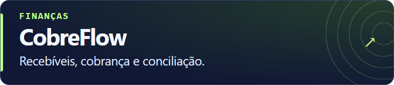
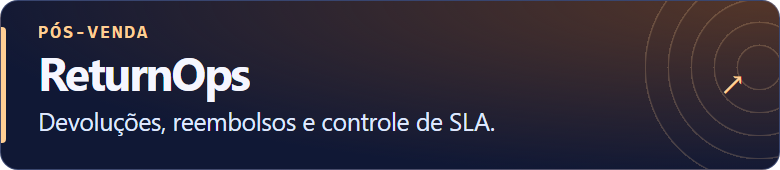

<picture>
  <source media="(max-width: 600px)" srcset="https://raw.githubusercontent.com/Kenjihidehira/Kenjihidehira/main/assets/capa-portfolio-mobile.png">
  
</picture>

  

---

## Projetos em destaque

### Jusimed

`Estoque de dispositivos médicos` · `Protótipo independente`

Protótipo web para acompanhar o saldo por lote, validade e localização. O fluxo conecta o pedido à reserva, à conferência e à expedição, com dados fictícios.

**[Explorar o projeto ↗](https://github.com/Kenjihidehira/jusimed-estoque-prototipo#readme)** · [Ler a proposta](https://github.com/Kenjihidehira/jusimed-estoque-prototipo/blob/main/docs/proposta-apresentacao.md)

---

### Patrimônio Ops

`Inventário e custódia` · `Sistema com acesso autenticado`

Sistema de controle patrimonial por núcleo. Reúne inventário de ativos, importação de dados, emissão de termos de custódia e histórico de movimentações para auditoria.

**[Ver código ↗](https://github.com/Kenjihidehira/patrimonio-ops-control)** · [Ler arquitetura](https://github.com/Kenjihidehira/patrimonio-ops-control/blob/main/docs/arquitetura.md) · [Acessar sistema (login)](https://patrimonio-ops-control.vercel.app/demo)

Captura do laboratório local com dados fictícios.

---

## Outros projetos

[Demonstração do CobreFlow ↗](https://cobreflow-finance.dadosepesquisa.chatgpt.site)

[Demonstração do FieldOps ↗](https://fieldops-margin.dadosepesquisa.chatgpt.site)

[Demonstração do LeadOps ↗](https://leadops-attribution.dadosepesquisa.chatgpt.site)

[Demonstração do ReturnOps ↗](https://returnops-rma-control.dadosepesquisa.chatgpt.site)

[Demonstração do ServiceHub ↗](https://servicehub-crm-ops.dadosepesquisa.chatgpt.site)

---

## Sobre meu trabalho

## Contato

[Abrir proposta ↗](https://github.com/Kenjihidehira/Kenjihidehira/issues/new?title=Proposta%20de%20projeto) · [Todos os repositórios ↗](https://github.com/Kenjihidehira?tab=repositories)
