

<picture>
  <source media="(max-width: 700px)" srcset="./assets/v3/header-mobile.svg">
  
</picture>

  

 

## Projetos em destaque

<a href="https://github.com/Kenjihidehira/jusimed-estoque-prototipo#readme"></a>

<a href="./assets/v3/hemo-procedimentos.png">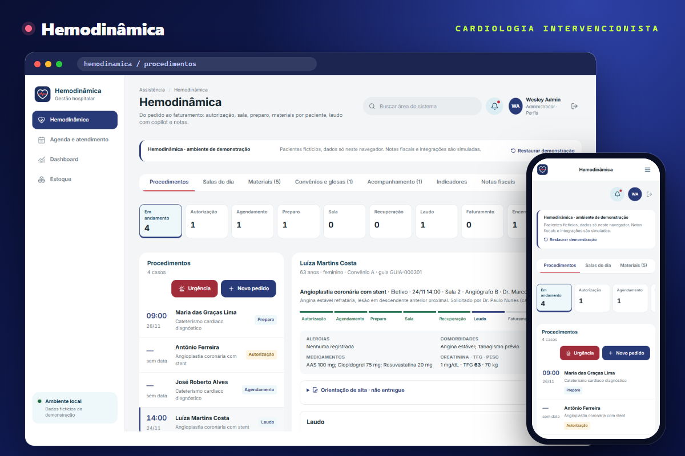</a>

**[Ver o projeto ↗](https://github.com/Kenjihidehira/jusimed-estoque-prototipo#readme)** · [Como funciona](https://github.com/Kenjihidehira/jusimed-estoque-prototipo/blob/main/docs/hemodinamica.md) · [Acesso e permissões](https://github.com/Kenjihidehira/jusimed-estoque-prototipo/blob/main/docs/acesso-e-permissoes.md)

<strong>Ver mais telas</strong> · urgência, sala, indicadores e materiais

 

<a href="./assets/v3/hemo-urgencia.png">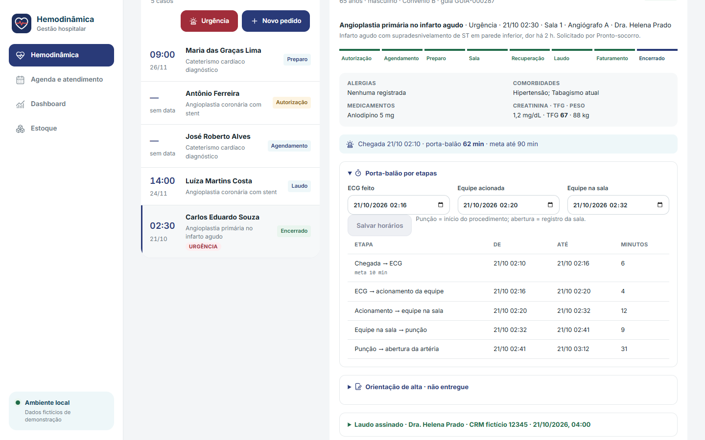</a>

<a href="./assets/v3/hemo-indicadores.png">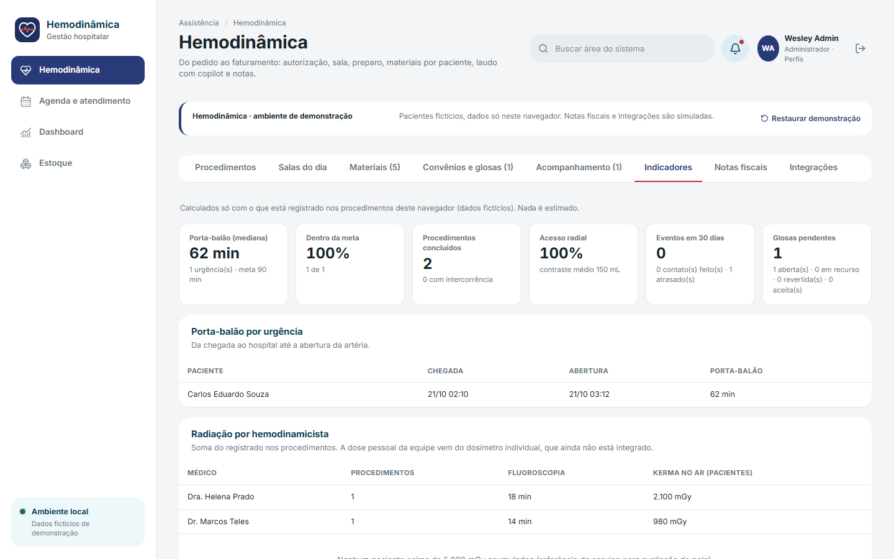</a>
<a href="./assets/v3/hemo-materiais.png">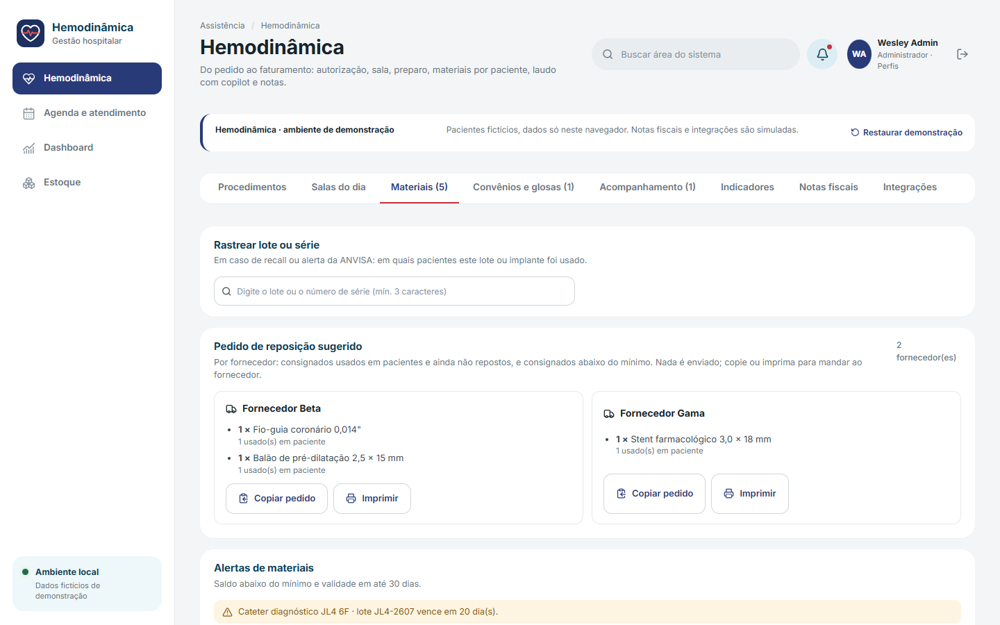</a>

<strong>Como o sistema funciona</strong> · fluxo, segurança clínica e IA

 

1. **Autorização e agendamento.** Pedido de OPME para o convênio e horário só onde sala, médico e paciente estão livres.
2. **Preparo e sala.** Time-out, consentimento assinado na tela, materiais saindo do lote certo e implantes com número de série.
3. **Laudo e faturamento.** Laudo assinado pelo hemodinamicista, prévia da guia TISS, glosas com recurso e notas simuladas.

- **Segurança clínica:** função renal estimada, limite sugerido de contraste, porta-balão por etapas, TCA e pulseira radial. O sistema registra, calcula e lembra, mas não sugere dose.
- **Copilot com a API do Claude:** resumo do caso, rascunho do laudo e do recurso de glosa. O caso é enviado sem o nome e sem o contato do paciente.

 

<a href="https://github.com/Kenjihidehira/patrimonio-ops-control"></a>

**[Ver código ↗](https://github.com/Kenjihidehira/patrimonio-ops-control)** · [Acessar a demonstração (login)](https://patrimonio-ops-control.vercel.app/demo) · [Arquitetura](https://github.com/Kenjihidehira/patrimonio-ops-control/blob/main/docs/arquitetura.md)

<strong>Como o sistema funciona</strong> · inventário, custódia e auditoria

 

1. **Cadastrar ou importar ativos** e consultar os registros por núcleo.
2. **Acompanhar inventário e custódia** com termos e registro de movimentações.
3. **Consultar a trilha de auditoria** e revisar as permissões por perfil.

[Documentação da API](https://github.com/Kenjihidehira/patrimonio-ops-control/blob/main/docs/api.md) · [Controle de acesso](https://github.com/Kenjihidehira/patrimonio-ops-control/blob/main/docs/controle-de-acesso.md)

<a href="#inicio">↑ voltar ao topo</a>

## Outros projetos

Clique em uma área para abrir ou fechar. Cada cartão leva ao repositório.

<strong>Operações e negócios</strong> · 8 projetos, 5 com demonstração

 

<a href="https://github.com/Kenjihidehira/cobreflow-finance-ops"></a>
<a href="https://github.com/Kenjihidehira/fieldops-margin-control"></a>
<a href="https://github.com/Kenjihidehira/leadops-campaign-attribution"></a>
<a href="https://github.com/Kenjihidehira/returnops-rma-command-center"></a>
<a href="https://github.com/Kenjihidehira/servicehub-agendamentos-crm"></a>
<a href="https://github.com/Kenjihidehira/logix-ops-control-tower"></a>
<a href="https://github.com/Kenjihidehira/clinicflow-no-show-recovery"></a>
<a href="https://github.com/Kenjihidehira/vendoraudit-compliance-portal"></a>

Demonstrações: [CobreFlow ↗](https://cobreflow-finance.dadosepesquisa.chatgpt.site) · [FieldOps ↗](https://fieldops-margin.dadosepesquisa.chatgpt.site) · [LeadOps ↗](https://leadops-attribution.dadosepesquisa.chatgpt.site) · [ReturnOps ↗](https://returnops-rma-control.dadosepesquisa.chatgpt.site) · [ServiceHub ↗](https://servicehub-crm-ops.dadosepesquisa.chatgpt.site)

<strong>APIs, back-end e DevOps</strong> · 4 projetos em Node.js

 

<a href="https://github.com/Kenjihidehira/helpdesk-node-fullstack"></a>
<a href="https://github.com/Kenjihidehira/erp-estoque-node"></a>
<a href="https://github.com/Kenjihidehira/encurtador-url-node"></a>
<a href="https://github.com/Kenjihidehira/devops-atividade"></a>

Os projetos de API usam só o Node.js nativo, sem dependências externas, e têm testes com o executor do próprio Node.

<strong>Front-end</strong> · painéis e ferramentas em JavaScript

 

<a href="https://github.com/Kenjihidehira/dashboard-vendas-pro"></a>
<a href="https://github.com/Kenjihidehira/crm-pipeline-js"></a>
<a href="https://github.com/Kenjihidehira/planner-pro-js"></a>
<a href="https://github.com/Kenjihidehira/kanban-board"></a>

Outros estudos: [Lista de tarefas](https://github.com/Kenjihidehira/lista-tarefas) · [Pomodoro](https://github.com/Kenjihidehira/pomodoro-focus) · [Quiz](https://github.com/Kenjihidehira/quiz-dev-js) · [Catálogo de filmes](https://github.com/Kenjihidehira/catalogo-filmes) · [Controle financeiro](https://github.com/Kenjihidehira/controle-financeiro) · [Loja em PHP](https://github.com/Kenjihidehira/loja-php) · [Agenda em PHP](https://github.com/Kenjihidehira/agenda-php) · [API de notas](https://github.com/Kenjihidehira/notas-api-node) · [API de produtos](https://github.com/Kenjihidehira/api-produtos-node)

<a href="#inicio">↑ voltar ao topo</a>

## Em números

<picture>
  <source media="(max-width: 700px)" srcset="https://raw.githubusercontent.com/Kenjihidehira/Kenjihidehira/output/stats-mobile.svg">
  
</picture>

<picture>
  <source media="(prefers-color-scheme: dark)" srcset="https://raw.githubusercontent.com/Kenjihidehira/Kenjihidehira/output/snake-dark.svg">
  
</picture>

Os números e a animação são gerados todo dia por uma [GitHub Action](./.github/workflows/atualiza-perfil.yml) deste repositório.

## Como trabalho

<picture>
  <source media="(max-width: 700px)" srcset="./assets/v3/processo-mobile.svg">
  
</picture>

## Stack

  

<strong>Onde cada tecnologia aparece</strong>

 

| Tecnologia | Onde ver |
|---|---|
| React e TypeScript | [Hemodinâmica](https://github.com/Kenjihidehira/jusimed-estoque-prototipo) e [Patrimônio Ops](https://github.com/Kenjihidehira/patrimonio-ops-control) |
| Next.js e Tailwind CSS | [Patrimônio Ops](https://github.com/Kenjihidehira/patrimonio-ops-control) |
| Supabase e PostgreSQL | [Patrimônio Ops](https://github.com/Kenjihidehira/patrimonio-ops-control) |
| API do Claude (IA) | copilot da [Hemodinâmica](https://github.com/Kenjihidehira/jusimed-estoque-prototipo) |
| Node.js sem dependências | [Helpdesk](https://github.com/Kenjihidehira/helpdesk-node-fullstack), [ERP Estoque](https://github.com/Kenjihidehira/erp-estoque-node), [ClinicFlow](https://github.com/Kenjihidehira/clinicflow-no-show-recovery) e os projetos de operações |
| PHP | [FieldOps](https://github.com/Kenjihidehira/fieldops-margin-control), [Loja](https://github.com/Kenjihidehira/loja-php) e [Agenda](https://github.com/Kenjihidehira/agenda-php) |
| Docker e GitHub Actions | [TaskFlow](https://github.com/Kenjihidehira/devops-atividade) (deploy automático) e a integração contínua dos projetos de operações |

## Contato

[Abrir proposta ↗](https://github.com/Kenjihidehira/Kenjihidehira/issues/new?title=Proposta%20de%20projeto) · [Todos os repositórios ↗](https://github.com/Kenjihidehira?tab=repositories) · [↑ Voltar ao topo](#inicio)

