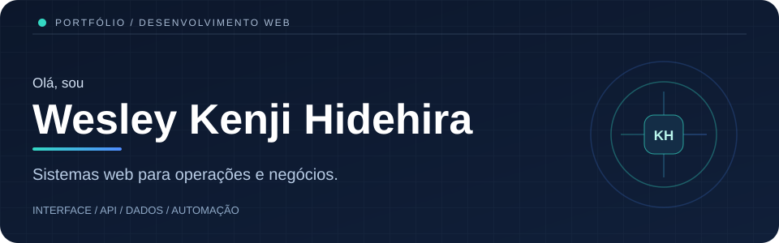

<picture>
  <source media="(max-width: 600px)" srcset="https://raw.githubusercontent.com/Kenjihidehira/Kenjihidehira/main/assets/hero-mobile.svg">
  
</picture>

  

**Transformo processos operacionais em sistemas claros, rastreáveis e fáceis de usar.**

[Destaques](#projetos-em-destaque) · [Outros projetos](#outros-projetos) · [Como trabalho](#como-trabalho) · [Tecnologias](#tecnologias) · [Contato](#contato)

---

## Projetos em destaque

### Jusimed · Estoque de dispositivos médicos

Protótipo independente e não oficial, com dados fictícios. Demonstra o fluxo de estoque de dispositivos médicos, do controle de lote e validade à reserva, separação e expedição de pedidos.

**[Ver projeto e telas](https://github.com/Kenjihidehira/jusimed-estoque-prototipo#readme)** · [Ler a proposta](https://github.com/Kenjihidehira/jusimed-estoque-prototipo/blob/main/docs/proposta-apresentacao.md)

### Patrimônio Ops · Inventário e custódia

Sistema de controle patrimonial por núcleo. Reúne inventário de ativos, termos de custódia, importação de dados e trilha de auditoria, com acesso autenticado.

**[Abrir demonstração](https://patrimonio-ops-control.vercel.app/demo)** · [Ver código](https://github.com/Kenjihidehira/patrimonio-ops-control) · [Ler arquitetura](https://github.com/Kenjihidehira/patrimonio-ops-control/blob/main/docs/arquitetura.md)

---

## Outros projetos

Sistemas para problemas diferentes, com código e demonstrações acessíveis.

| Projeto | O que resolve | Acessar |
| --- | --- | --- |
| **CobreFlow** | Recebíveis, cobrança e conciliação | [Demo](https://cobreflow-finance.dadosepesquisa.chatgpt.site) · [Código](https://github.com/Kenjihidehira/cobreflow-finance-ops) |
| **FieldOps** | Margem, SLA e serviços em campo | [Demo](https://fieldops-margin.dadosepesquisa.chatgpt.site) · [Código](https://github.com/Kenjihidehira/fieldops-margin-control) |
| **LeadOps** | Atribuição, pontuação de leads e campanhas | [Demo](https://leadops-attribution.dadosepesquisa.chatgpt.site) · [Código](https://github.com/Kenjihidehira/leadops-campaign-attribution) |
| **ReturnOps** | Devoluções, reembolsos e controle de SLA | [Demo](https://returnops-rma-control.dadosepesquisa.chatgpt.site) · [Código](https://github.com/Kenjihidehira/returnops-rma-command-center) |
| **ServiceHub** | Agenda, funil e cobranças para serviços | [Demo](https://servicehub-crm-ops.dadosepesquisa.chatgpt.site) · [Código](https://github.com/Kenjihidehira/servicehub-agendamentos-crm) |

## Como trabalho

**Entender o processo → modelar regras e dados → construir a interface e a API → validar os fluxos.**

Nos repositórios, você encontra as decisões de arquitetura, instruções de execução e testes de cada projeto. As demonstrações permitem avaliar o fluxo antes de examinar o código.

## Tecnologias

TypeScript · JavaScript · Node.js · PHP · SQL · Supabase · GitHub Actions

Aplico cada ferramenta conforme o problema e explico as escolhas no repositório correspondente.

## Contato

Para conversar sobre um projeto, [abra uma proposta neste repositório](https://github.com/Kenjihidehira/Kenjihidehira/issues/new?title=Proposta%20de%20projeto) ou explore [todos os meus repositórios](https://github.com/Kenjihidehira?tab=repositories).

Douradina, Paraná · Brasil
