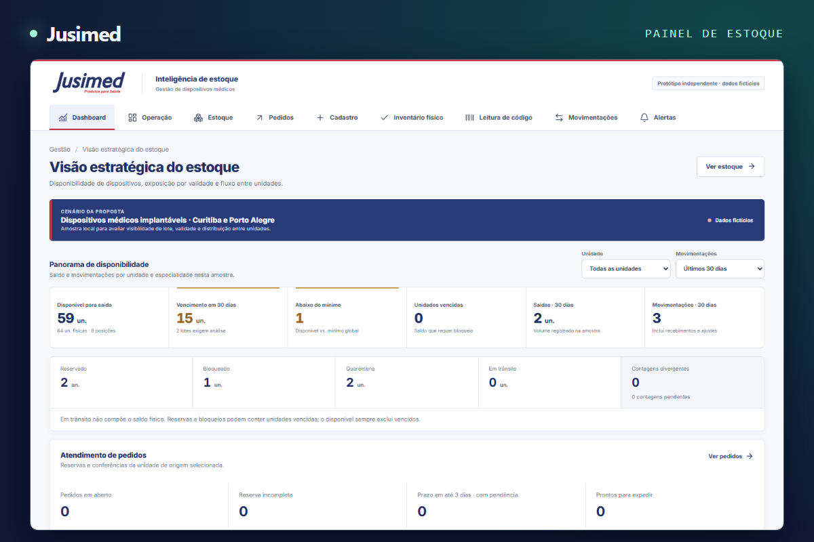
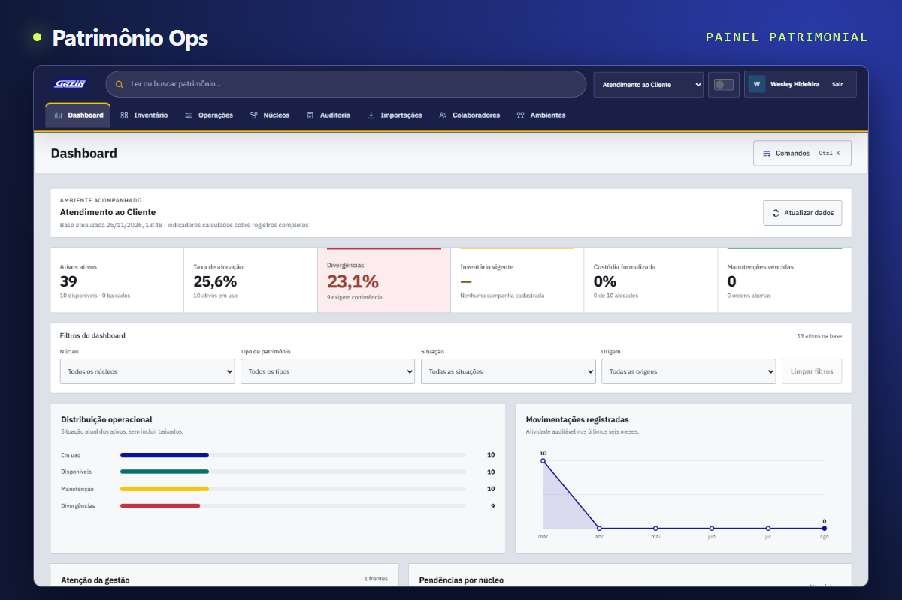

<picture>
  <source media="(max-width: 600px)" srcset="https://raw.githubusercontent.com/Kenjihidehira/Kenjihidehira/main/assets/capa-portfolio-mobile.png">
  
</picture>

  

**[Jusimed](#jusimed)** &nbsp;·&nbsp; **[Patrimônio Ops](#patrimônio-ops)** &nbsp;·&nbsp; [Outros projetos](#outros-projetos) &nbsp;·&nbsp; [Contato](#contato)

---

## Projetos em destaque

### Jusimed

`Estoque de dispositivos médicos` · `Protótipo independente`

Protótipo web para acompanhar o saldo por lote, validade e localização. O fluxo conecta o pedido à reserva, à conferência e à expedição, com dados fictícios.

**[Explorar o projeto ↗](https://github.com/Kenjihidehira/jusimed-estoque-prototipo#readme)** · [Ler a proposta](https://github.com/Kenjihidehira/jusimed-estoque-prototipo/blob/main/docs/proposta-apresentacao.md)

Dados fictícios · Clique na imagem para ampliar.

---

### Patrimônio Ops

`Inventário e custódia` · `Sistema com acesso autenticado`

Sistema de controle patrimonial por núcleo. Reúne inventário de ativos, importação de dados, emissão de termos de custódia e histórico de movimentações para auditoria.

**[Ver código ↗](https://github.com/Kenjihidehira/patrimonio-ops-control)** · [Ler arquitetura](https://github.com/Kenjihidehira/patrimonio-ops-control/blob/main/docs/arquitetura.md) · [Acessar sistema (login)](https://patrimonio-ops-control.vercel.app/demo)

Laboratório local com dados fictícios · Clique na imagem para ampliar.

---

## Outros projetos

| Projeto | O que resolve | Acessar |
| --- | --- | --- |
| **CobreFlow** | Recebíveis, cobrança e conciliação | [Demo](https://cobreflow-finance.dadosepesquisa.chatgpt.site) · [Código](https://github.com/Kenjihidehira/cobreflow-finance-ops) |
| **FieldOps** | Margem, SLA e serviços em campo | [Demo](https://fieldops-margin.dadosepesquisa.chatgpt.site) · [Código](https://github.com/Kenjihidehira/fieldops-margin-control) |
| **LeadOps** | Atribuição, pontuação de leads e campanhas | [Demo](https://leadops-attribution.dadosepesquisa.chatgpt.site) · [Código](https://github.com/Kenjihidehira/leadops-campaign-attribution) |
| **ReturnOps** | Devoluções, reembolsos e controle de SLA | [Demo](https://returnops-rma-control.dadosepesquisa.chatgpt.site) · [Código](https://github.com/Kenjihidehira/returnops-rma-command-center) |
| **ServiceHub** | Agenda, funil e cobranças para serviços | [Demo](https://servicehub-crm-ops.dadosepesquisa.chatgpt.site) · [Código](https://github.com/Kenjihidehira/servicehub-agendamentos-crm) |

## Como trabalho

Começo pelo fluxo de quem usa o sistema. A partir dele, modelo as regras e os dados, construo a interface e a API e testo os cenários críticos.

## Tecnologias

`TypeScript` · `JavaScript` · `Node.js` · `PHP` · `SQL` · `Supabase` · `GitHub Actions`

## Contato

Para conversar sobre um projeto, [abra uma proposta neste repositório](https://github.com/Kenjihidehira/Kenjihidehira/issues/new?title=Proposta%20de%20projeto) ou explore [todos os meus repositórios](https://github.com/Kenjihidehira?tab=repositories).

Douradina, Paraná · Brasil
