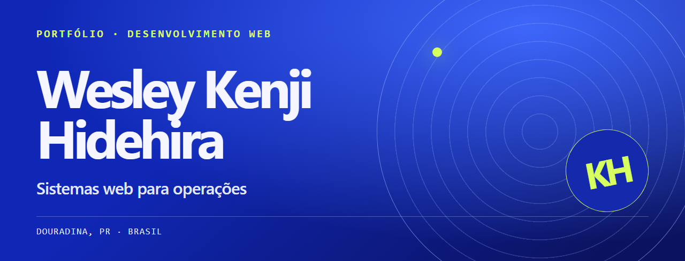
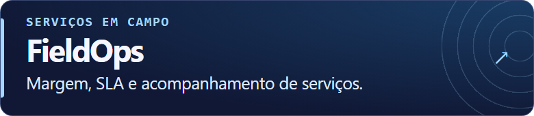

<picture>
  <source media="(max-width: 600px)" srcset="https://raw.githubusercontent.com/Kenjihidehira/Kenjihidehira/main/assets/capa-portfolio-mobile.png">
  
</picture>

  

---

## Projetos em destaque

### Jusimed

`Estoque de dispositivos médicos` · `Protótipo independente`

Protótipo web para acompanhar o saldo por lote, validade e localização. O fluxo conecta o pedido à reserva, à conferência e à expedição, com dados fictícios.

**[Explorar o projeto ↗](https://github.com/Kenjihidehira/jusimed-estoque-prototipo#readme)** · [Ler a proposta](https://github.com/Kenjihidehira/jusimed-estoque-prototipo/blob/main/docs/proposta-apresentacao.md)

<strong>Explorar o fluxo do Jusimed</strong>

1. **Consultar o estoque** por lote, validade e localização.
2. **Reservar e separar o pedido** com conferência de código, lote e quantidade.
3. **Expedir** e acompanhar a baixa de saldo no histórico do pedido.

[Ampliar o painel](./assets/portfolio-jusimed-current.png) · [Ver regras de pedidos e expedição](https://github.com/Kenjihidehira/jusimed-estoque-prototipo/blob/main/docs/pedidos-expedicao.md) · [Consultar os indicadores](https://github.com/Kenjihidehira/jusimed-estoque-prototipo/blob/main/docs/analytics.md)

---

### Patrimônio Ops

`Inventário e custódia` · `Sistema com acesso autenticado`

Sistema de controle patrimonial por núcleo. Reúne inventário de ativos, importação de dados, emissão de termos de custódia e histórico de movimentações para auditoria.

**[Ver código ↗](https://github.com/Kenjihidehira/patrimonio-ops-control)** · [Ler arquitetura](https://github.com/Kenjihidehira/patrimonio-ops-control/blob/main/docs/arquitetura.md) · [Acessar sistema (login)](https://patrimonio-ops-control.vercel.app/demo)

Captura do laboratório local com dados fictícios.

<strong>Explorar o fluxo do Patrimônio Ops</strong>

1. **Cadastrar ou importar ativos** e consultar os registros por núcleo.
2. **Acompanhar inventário e custódia** com termos e registro de movimentações.
3. **Consultar a trilha de auditoria** e revisar as permissões por perfil.

[Ampliar o painel](./assets/portfolio-patrimonio-current.png) · [Ver documentação da API](https://github.com/Kenjihidehira/patrimonio-ops-control/blob/main/docs/api.md) · [Consultar controle de acesso](https://github.com/Kenjihidehira/patrimonio-ops-control/blob/main/docs/controle-de-acesso.md)

[↑ Voltar ao menu](#inicio)

---

## Outros projetos

[Finanças](#cobreflow) · [Serviços em campo](#fieldops) · [Marketing](#leadops) · [Pós-venda](#returnops) · [Gestão comercial](#servicehub)

[Demonstração do CobreFlow ↗](https://cobreflow-finance.dadosepesquisa.chatgpt.site)

[Demonstração do FieldOps ↗](https://fieldops-margin.dadosepesquisa.chatgpt.site)

[Demonstração do LeadOps ↗](https://leadops-attribution.dadosepesquisa.chatgpt.site)

[Demonstração do ReturnOps ↗](https://returnops-rma-control.dadosepesquisa.chatgpt.site)

[Demonstração do ServiceHub ↗](https://servicehub-crm-ops.dadosepesquisa.chatgpt.site)

---

## Sobre meu trabalho

<strong>Ver como aplico essas tecnologias</strong>

- **Interface e regras de estoque.** Veja como o [protótipo Jusimed](https://github.com/Kenjihidehira/jusimed-estoque-prototipo#estrutura) organiza a interface React e as regras em TypeScript.
- **Dados e acesso.** A [arquitetura do Patrimônio Ops](https://github.com/Kenjihidehira/patrimonio-ops-control/blob/main/docs/arquitetura.md) documenta a integração entre aplicação, autenticação e persistência.

## Contato

[Abrir proposta ↗](https://github.com/Kenjihidehira/Kenjihidehira/issues/new?title=Proposta%20de%20projeto) · [Todos os repositórios ↗](https://github.com/Kenjihidehira?tab=repositories)

[↑ Voltar ao menu](#inicio)
